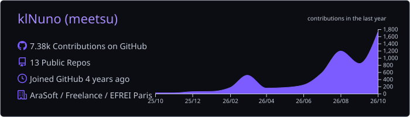

Studio: [MTSU](https://mtsu.dev).

### Projects

- [**Boite**](https://github.com/mtsu-dev/boite) - Desktop workspace for coding agents, with access from your phone ([legacy terminal app](https://github.com/beboite/boite-legacy))
- [**accshift**](https://github.com/klNuno/accshift) - Switch gaming accounts in one click on Windows, macOS and Linux
- [**Douane**](https://github.com/mtsu-dev/douane) - Use your AI subscriptions in any coding tool through one self-hosted gateway, with quota-aware routing

### Games
- [**Mining Miner**](https://store.steampowered.com/app/2303330/Mining_Miner/) - Incremental mining game on Steam, made with [Skollheim](https://github.com/Skollheim)
- ??? soon

### Small projects

**AI**
- [fastpick](https://github.com/mtsu-dev/fastpick) - Pick your coding agent, provider and model from the terminal (+ a roulette if you cannot decide).
- [fast-mcp-ssh](https://github.com/klNuno/fast-mcp-ssh) - SSH, SFTP and remote screenshots for AI agents in one Rust binary.
- [B.O.T.S](https://github.com/Skollheim/bots) - Desktop robots that follow your Boite agents, handle requests and run scheduled missions.

**Desktop and gaming**
- [Windows Bagarre](https://github.com/klNuno/windows-bagarre) - Debloat and tune a fresh Windows 11 install for gaming.
- [gammich](https://github.com/klNuno/gammich) - Browse, tag and search your game clip recordings in a self-hosted web library.
- [Spotivita](https://github.com/klNuno/spotivita) - Play Spotify on the PS Vita, with your library, search, artist pages and Spotify Connect.

**Utilities**
- [PriceHover](https://github.com/klNuno/PriceHover) - Convert currency and crypto prices on hover, on selection or inline in Chrome and Firefox.

**Other**
- [lsd-decomp](https://github.com/klNuno/lsd-decomp) - Matching decompilation of LSD: Dream Emulator (PS1), in progress.

 

  

<picture>
  <source media="(prefers-color-scheme: dark)" srcset="https://raw.githubusercontent.com/klNuno/klNuno/output/snake-dark.svg">
  <source media="(prefers-color-scheme: light)" srcset="https://raw.githubusercontent.com/klNuno/klNuno/output/snake.svg">
  
</picture>

